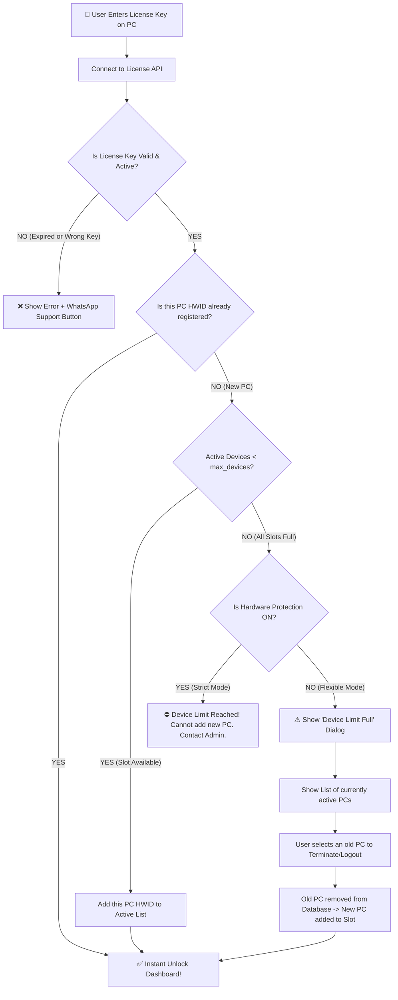

# 🔑 Phone Link Hub — Complete Smart Multi-Device License System & Commercialization Guide

> **Target Audience:** Beginner / Non-Coder Friendly Guide  
> **Official Support WhatsApp:** [+91 8418944572](https://wa.me/918418944572?text=Hello%20Admin,%20I%20need%20support%20with%20Phone%20Link%20Hub%20License)  
> **Purpose:** Phone Link Hub ko final Windows `.exe` banane se pehle usme **Smart Multi-PC License Key Protection**, **Dynamic Device Transfer Slots**, aur **Anti-Tamper Security** implement karna.

---

## 📌 Index (Is Guide me kya-kya hai?)
1. [Naye Smart License System Ka Concept (Problem & Solution)](#1-naye-smart-license-system-ka-concept)
2. [Multi-PC Slot System (1 PC vs 2 PC Plan)](#2-multi-pc-slot-system-1-pc-vs-2-pc-plan)
3. [Hardware Protection Switch (Strict vs Flexible Transfer Mode)](#3-hardware-protection-switch-strict-vs-flexible-transfer-mode)
4. [User Flowchart: Jab Naya PC Detect Hoga](#4-user-flowchart-jab-naya-pc-detect-hoga)
5. [License Data Structure (Admin Database Format)](#5-license-data-structure-admin-database-format)
6. [Dashboard Activation UI & WhatsApp Support Button](#6-dashboard-activation-ui--whatsapp-support-button)
7. [Anti-Piracy, Anti-Clock-Tamper & Security Rules](#7-anti-piracy-anti-clock-tamper--security-rules)
8. [Final Windows .EXE Packaging Roadmap](#8-final-windows-exe-packaging-roadmap)

---

## 1. Naye Smart License System Ka Concept

### ❌ Purana Strict HWID System Kyun Galat Tha?
Pehle agar kisi customer ne license kharida aur wo ek PC par bind ho gaya, to agar customer ne naya laptop kharida ya office ke dusre PC par shift karna chaha, to wo key expire/invalid ho jati thi. Customer pareshan hokar support mangta tha.

### ✅ Naya Smart Dynamic Slot System (Humara Solution):
1. **Multi-PC Support:** Ek hi key se 1 PC, 2 PC, ya 3 PC chal sakte hain (Customer ke plan ke hisab se).
2. **Dynamic PC Switch (Self-Service Transfer):** Agar user naye PC par gaya aur purana PC band karna chahta hai, to wo purane PC ko terminate/logout karke naye PC ko connect kar sakta hai — bina admin ko baar-baar call kiye!
3. **Admin Hardware Protection Override:** Admin dashboard se decide kar sakta hai ki kisi particular key ke liye hardware lock **STRICT** rakhna hai ya **FLEXIBLE**.

---

## 2. Multi-PC Slot System (1 PC vs 2 PC Plan)

Aap customer ko alag-alag plans bech sakte ho:

| Plan Name | Allowed Devices (`max_devices`) | Price Example | Kaise Kaam Karega? |
|---|:---:|---|---|
| **Single PC Plan** | `1 PC` | ₹499 / mo | Ek waqt me sirf 1 computer dashboard chala sakta hai. |
| **Duo PC Plan** | `2 PCs` | ₹799 / mo | **Same ek hi license key** do computers (e.g. Home PC + Laptop) par ek sath chalegi. |
| **Family / Office Plan** | `3 - 5 PCs` | ₹1499 / mo | Same key 3 se 5 systems par simultaneously active rahegi. |
| **Free 3-Day Trial** | `1 PC` | Free | 3 din baad automatically expire ho jayegi. |

---

## 3. Hardware Protection Switch (Strict vs Flexible Transfer Mode)

Admin ke control panel me har key ke samne ek toggle button hoga:  
`Hardware Protection: [ ON / OFF ]`

### 🔒 Case A: Hardware Protection = ON (Strict Mode)
- **Kiske liye:** Jab aap kisi ko ek specific PC ke liye key dete ho aur transfer allow nahi karna chahte.
- **Kaisa behaviour hoga:**
  - Agar 1 PC ki key hai aur user ne PC #1 par activate kiya, to wo PC #1 se permanently lock ho gaya.
  - Agar wo PC #2 par wahi key daalega, to screen par aayega:
    > ❌ **"Hardware Lock Active:** This key is strictly bound to its registered machine. Activation on this new device is blocked. Contact Admin on WhatsApp (+91 8418944572)."

### 🔄 Case B: Hardware Protection = OFF (Flexible / Transfer Mode)
- **Kiske liye:** General customers jo laptop badalte hain ya ghar/office switch karte hain.
- **Kaisa behaviour hoga:**
  - Maan lo customer ka **2 PC Plan** hai aur uske do computers (PC-A aur PC-B) already connected hain.
  - Ab usne naya PC-C khareeda aur wahan key daali.
  - System bolta hai:
    > ⚠️ **"New PC Detected! Device limit reached (2/2 Active):**  
    > Aapka 2-PC quota full hai. Naye PC ko jodne ke liye kripya kisi ek purane computer ko disconnect (terminate) karein."
  - User ke samne screen par dono purane PCs ki list dikhegi:
    - `[🖥️ Dell Laptop - Active since 12 Oct] -> [ Disconnect & Replace ]`
    - `[🖥️ Home Desktop - Active since 15 Oct] -> [ Disconnect & Replace ]`
  - User ne "Dell Laptop" par Disconnect dabaya ➔ Dell Laptop ka access turant revoke ho gaya ➔ Naye PC-C ka HWID database me register ho gaya aur software successfully unlock ho gaya!

---

## 4. User Flowchart: Jab Naya PC Detect Hoga



---

## 5. License Data Structure (Admin Database Format)

Humara license database (Supabase / Cloud JSON) me har license ka format aisa hoga:

```json
{
  "license_key": "PLH-9921-4820-K109",
  "customer_name": "Suaib Khan",
  "customer_phone": "8418944572",
  "plan_type": "Duo_Pro_2PC",
  "max_devices": 2,
  "hardware_protection": false,
  "status": "ACTIVE",
  "valid_until": "2027-10-19T23:59:59Z",
  "registered_devices": [
    {
      "hwid": "MOTO-WIN-B94A-21E0",
      "device_name": "Lenovo Legion Laptop",
      "first_activated": "2026-10-18T14:20:00Z",
      "last_seen": "2026-10-19T09:00:00Z"
    },
    {
      "hwid": "DESKTOP-882C-4411",
      "device_name": "Shop Desktop PC",
      "first_activated": "2026-10-18T18:30:00Z",
      "last_seen": "2026-10-19T08:45:00Z"
    }
  ]
}
```

---

## 6. Dashboard Activation UI & WhatsApp Support Button

Dashboard me jo License Modal pop-up aayega, usme:

1. **Machine HWID Box:**
   - User ke PC ka automatic hardware fingerprint display hoga:
   - `Your Machine ID: PLH-WIN-77B1-904A` `[ 📋 Copy HWID ]`
2. **License Input Field:**
   - `Enter Key: PLH-XXXX-XXXX-XXXX`
3. **Devices Slot Indicator:**
   - Activation ke baad dashboard ke footer me dikhega:  
     `Active Devices: 2 / 2 PCs Connected • Plan: Pro Duo (Valid till Oct 2027)`
4. **Official WhatsApp Click-To-Chat Button:**
   - Har error, expired notice, ya buy prompt par direct link:
   - **URL:** `https://wa.me/918418944572?text=Hello%20Admin,%20I%20need%20help%20with%20Phone%20Link%20Hub%20License`
   - Button text: **"💬 WhatsApp Support (+91 8418944572)"**

---

## 7. Anti-Piracy, Anti-Clock-Tamper & Security Rules

1. **System Clock Rollback Protection:**
   - Agar koi user PC ki date 2 saal piche kar dega taaki expiry date na aaye:
   - Software local monotonic tick counter aur internet trusted time server (NTP) se match karega. Agar time mismatch mila ➔ Instantly Freeze!
2. **Encrypted Token Cache (`license.lic`):**
   - Jab key activate hogi, to local PC par AES-256 encrypted token save hoga jisme `expiry` aur `device_hwid` signed hoga.
   - User notepad se file edit karke date change nahi kar sakta; edit karte hi hash mismatch hoga aur file reject ho jayegi.
3. **Ghost Machine Auto-Expiry:**
   - Agar koi PC 60 din tak internet se connect nahi hua, to admin ek click me use "Inactive" mark karke slot khali kar sakta hai.

---

## 8. Final Windows .EXE Packaging Roadmap

Jab ye pura License module code me connect aur test ho jayega:

```
[Phase 1: License Integration]
      │
      ├── 1. Add HWID Generator in server
      ├── 2. Add License Check Middleware in Express (port 5000)
      ├── 3. Add Activation Modal + Multi-PC Transfer Dialog in React Dashboard
      └── 4. Connect Click-to-Chat WhatsApp (+91 8418944572)
      │
[Phase 2: Live Testing]
      │
      ├── 1 PC test, 2 PC test, Device Limit reached test, Disconnect/Terminate test
      │
[Phase 3: Final Windows .EXE Compilation]
      │
      ├── Pack Node Server + React Web into Standalone Windows Application
      ├── Custom AMOLED Cyber Icon (.ico)
      └── Single installer setup file (PhoneLinkHub-Setup-v1.0.exe)
```

---

> 💬 **Admin Contact Reference:**  
> WhatsApp: `+91 8418944572`  
> Direct Chat Link: [wa.me/918418944572](https://wa.me/918418944572?text=Hello%20Admin,%20I%20am%20testing%20Phone%20Link%20Hub)
